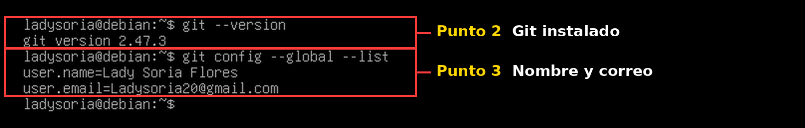
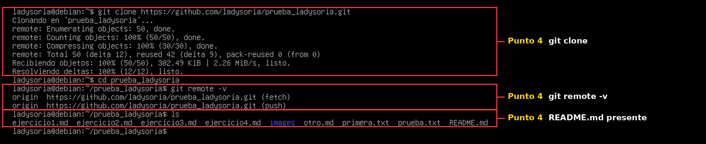
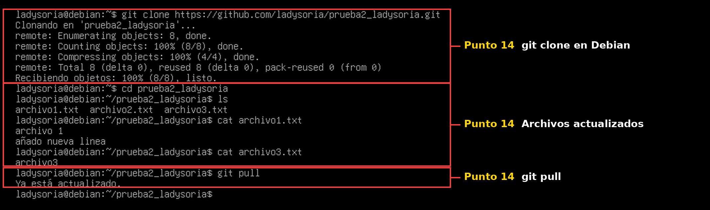

# Ejercicio 1: Introducción a Git y GitHub

## Puntos 2 y 3: instalar y configurar Git en Linux Debian 12

```
apt update
apt install git
git --version
git config --global user.name "Lady Soria Flores"
git config --global user.email "Ladysoria20@gmail.com"
git config --global --list
```



## Punto 4: clonar el repositorio prueba_ladysoria en Debian

```
git clone https://github.com/ladysoria/prueba_ladysoria.git
cd prueba_ladysoria
git remote -v
ls
```



## Apartado 14: repositorio prueba2_ladysoria

### 1. Crear el repositorio local en Windows

```
mkdir prueba2_ladysoria
cd prueba2_ladysoria
git init
echo "Contenido del archivo 1" > archivo1.txt
echo "Contenido del archivo 2" > archivo2.txt
git add .
git commit -m "añadir dos ficheros"
```

### 2. Conectar con GitHub y subirlo

```
git remote add origin https://github.com/Ladysoria/prueba2_ladysoria.git
git push -u origin master
```

### 3. Clonar en la máquina Linux Debian

```
git clone https://github.com/ladysoria/prueba2_ladysoria.git
cd prueba2_ladysoria
ls
```

### 4. Modificar un archivo y crear archivo3.txt en Windows

```
echo "añado nueva linea" >> archivo1.txt
echo "archivo3" > archivo3.txt
git add .
git commit -m "modifique el fichero"
git push
```

### 5. Actualizar en Linux Debian

```
git pull
cat archivo1.txt
cat archivo3.txt
```

En Debian se comprueba que `archivo1.txt` tiene la línea nueva y que aparece `archivo3.txt`:

