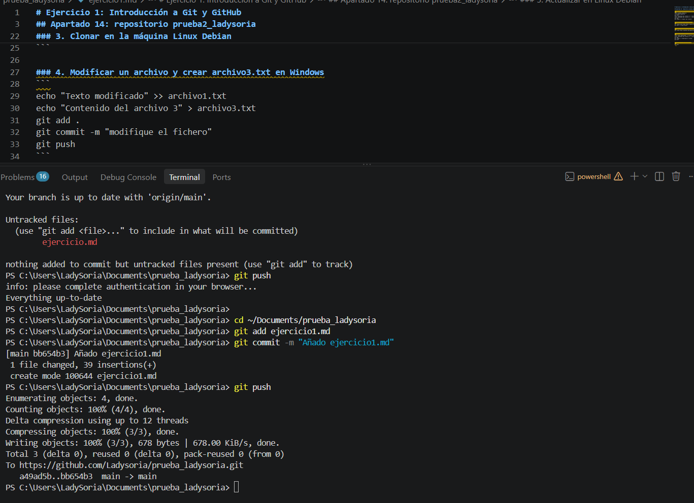

# Ejercicio 2: Introducción a Markdown

## Elementos básicos de la sintaxis

Este es un párrafo de ejemplo con una palabra en **negrita**, otra en *cursiva* y un comando escrito como `código`, por ejemplo `git status`.

```bash
git add .
git commit -m "Mi primer commit"
git push
```

1. Crear el repositorio
2. Añadir los archivos
3. Hacer commit
4. Subir los cambios

* Git
* GitHub
* Markdown
* Visual Studio Code

[Página oficial de Git](https://git-scm.com)

[Ver otro documento del repositorio](otro.md)



| Comando | Función |
| --- | --- |
| git add | Añade archivos al área de preparación |
| git commit | Guarda los cambios en el repositorio local |
| git push | Sube los cambios a GitHub |