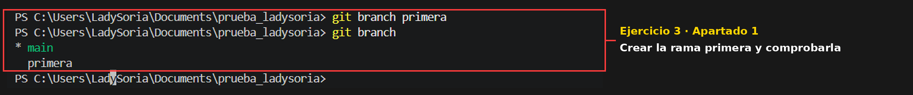
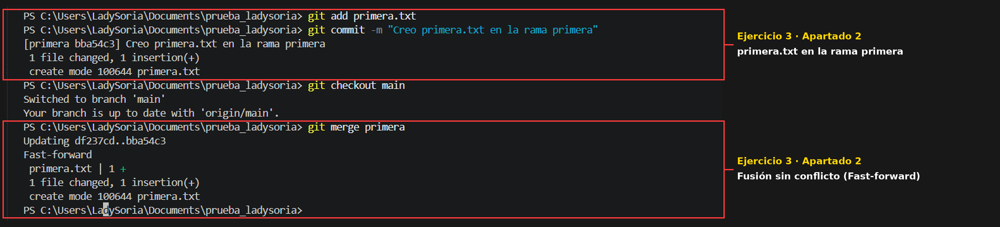
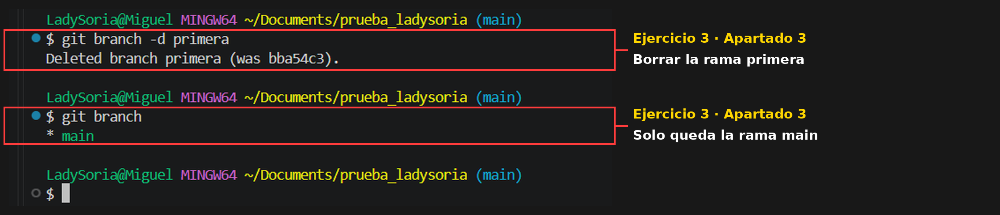
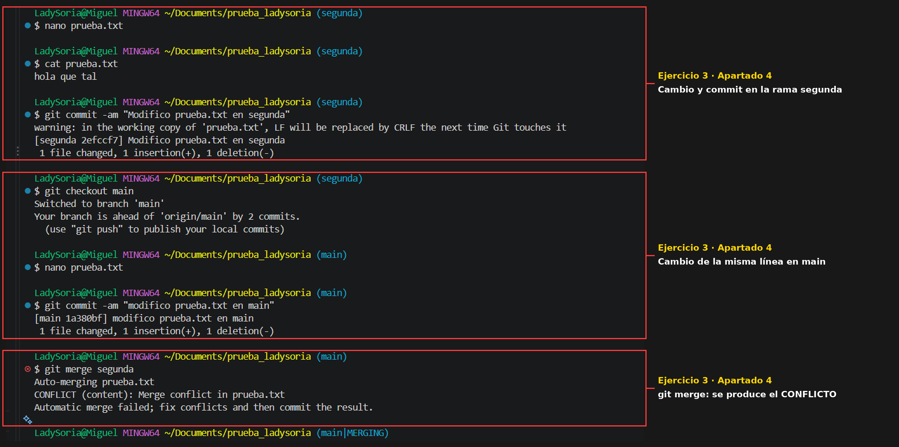
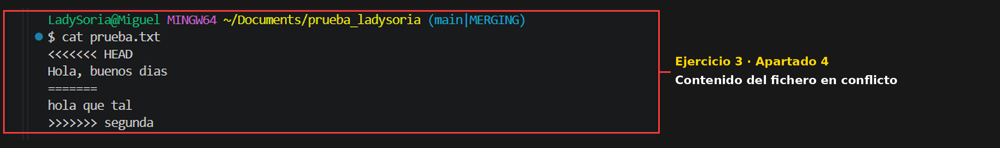
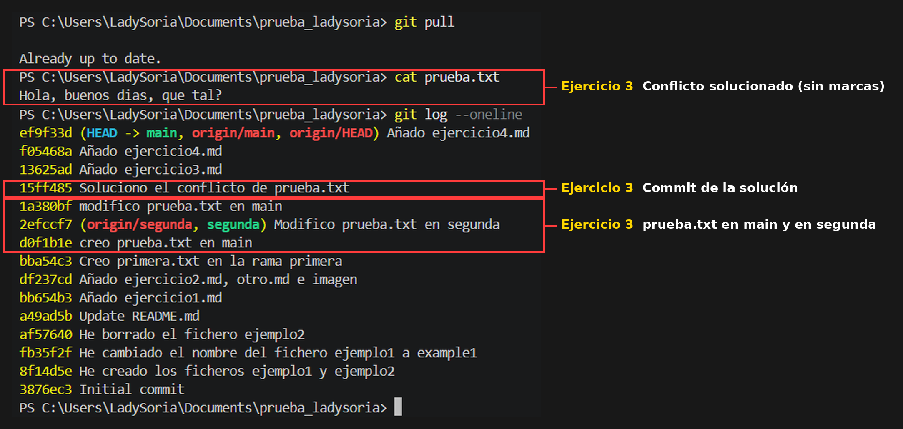
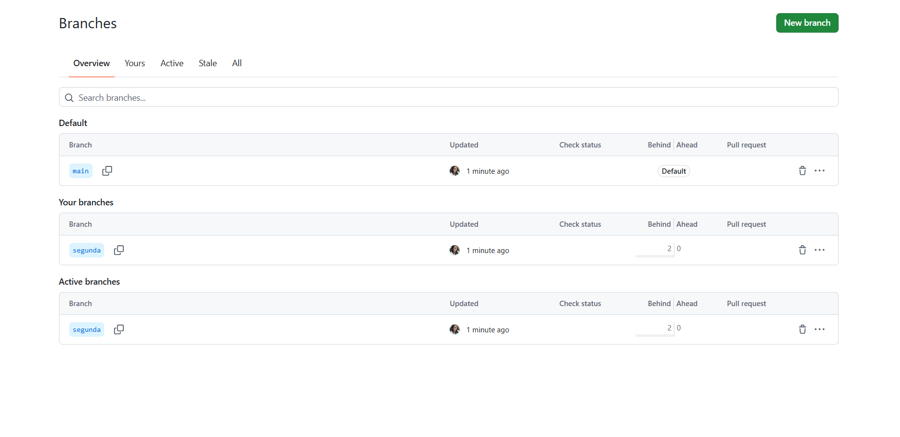

# Ejercicio 3: Git. Trabajando con ramas y uniones

## 1. Crear la rama primera y comprobar que existe

```
git branch primera
git branch
```



## 2. Crear un fichero en la rama primera y fusionarlo con la principal

```
git checkout primera
nano primera.txt
git add primera.txt
git commit -m "Creo primera.txt en la rama primera"
git checkout main
git merge primera
```



**¿Se ha producido conflicto?** No. En la rama primera solo se ha **añadido** un fichero nuevo que no existía en la rama main, por lo que Git simplemente lo incorpora a la rama principal (*Fast-forward*). Los conflictos solo aparecen cuando se modifica la misma parte de un fichero en dos ramas diferentes.

## 3. Borrar la rama primera

```
git branch -d primera
git branch
```



## 4. Crear la rama segunda y producir un conflicto

```
nano prueba.txt
git add prueba.txt
git commit -m "Creo prueba.txt en main"
git checkout -b segunda
nano prueba.txt
git commit -am "Modifico prueba.txt en segunda"
git checkout main
nano prueba.txt
git commit -am "Modifico prueba.txt en main"
git merge segunda
```



Contenido del fichero donde se ha producido el conflicto:

```
$ cat prueba.txt
<<<<<<< HEAD
Hola, buenos días
=======
hola que tal
>>>>>>> segunda
```



## 5. Solucionar el conflicto y sincronizar la rama segunda en GitHub

```
nano prueba.txt
git add .
git commit -m "Soluciono el conflicto de prueba.txt"
git push
git push origin segunda
```

Fichero ya solucionado (sin las marcas del conflicto) y commit de la solución:



Rama segunda creada en el repositorio de GitHub:


