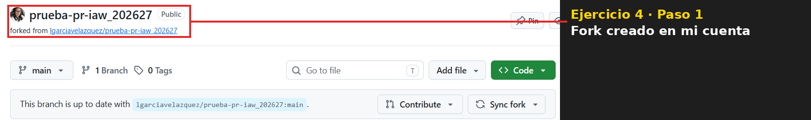
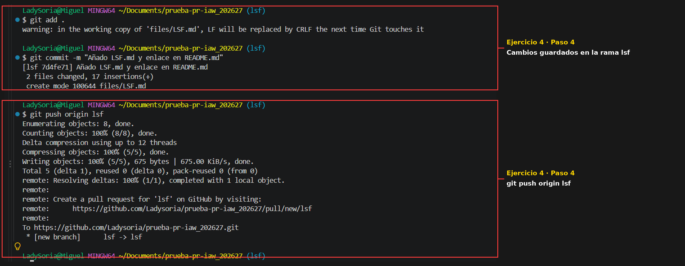
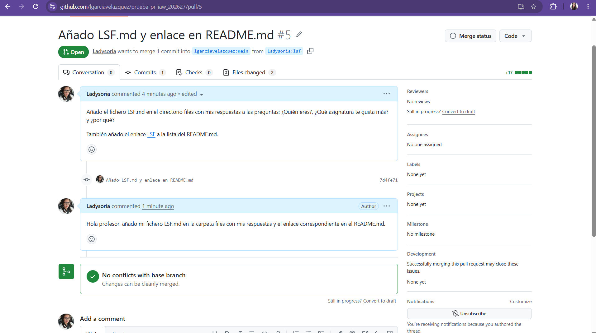
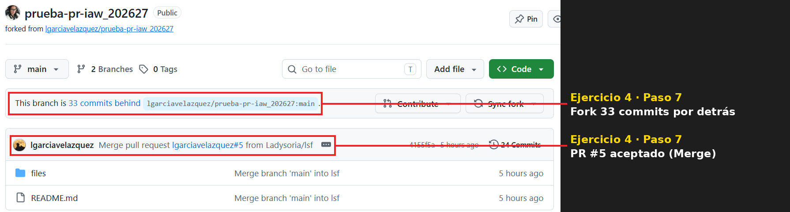
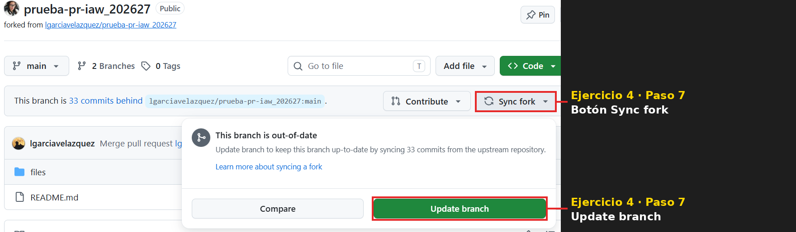
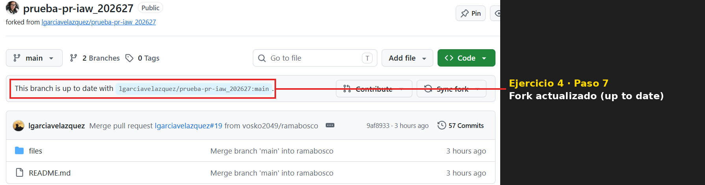
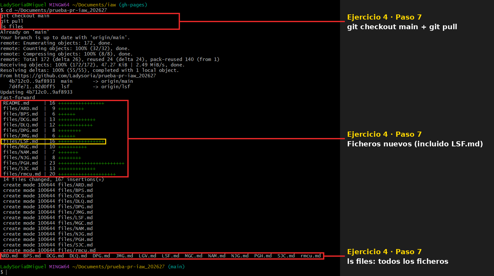

# Ejercicio 4: Pull Request

## 1. Hacer un fork del repositorio original

Desde la página de GitHub del repositorio `lgarciavelazquez/prueba-pr-iaw_202627`, pulso el botón **Fork** y después **Create fork**. Se crea una copia en mi cuenta: `Ladysoria/prueba-pr-iaw_202627`.



## 2. Clonar el fork en mi ordenador

```
git clone https://github.com/Ladysoria/prueba-pr-iaw_202627.git
cd prueba-pr-iaw_202627
```

## 3. Crear una rama nueva y cambiarme a ella

```
git branch lsf
git checkout lsf
```

## 4. Realizar los cambios

Creo el fichero con mis respuestas en el directorio `files`:

```
nano files/LSF.md
```

Añado el enlace a mi fichero en la lista del `README.md`:

```
nano README.md
```

```
- [LSF](files/LSF.md)
```

## 5. Confirmar los cambios y subir la rama a GitHub

```
git add .
git commit -m "Añado LSF.md y enlace en README.md"
git push origin lsf
```



## 6. Crear el Pull Request

Desde la página de mi fork en GitHub, pulso **Compare & pull request**, compruebo que el cambio va de `Ladysoria:lsf` a `lgarciavelazquez:main` y pulso **Create pull request**.



## 7. Sincronizar mi fork con el repositorio original

El profesor ha aceptado el Pull Request #5 (*Merge pull request #5 from Ladysoria/lsf*). Mi fork queda por detrás del repositorio original:



En mi fork de GitHub pulso **Sync fork** y después **Update branch**:



El fork queda actualizado con el repositorio original:



Por último, actualizo mi repositorio local para tener los ficheros de todos mis compañeros:

```
git checkout main
git pull
ls files
```


